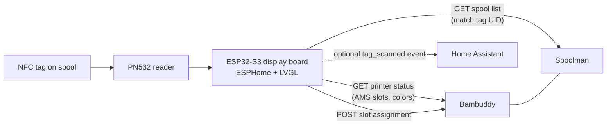
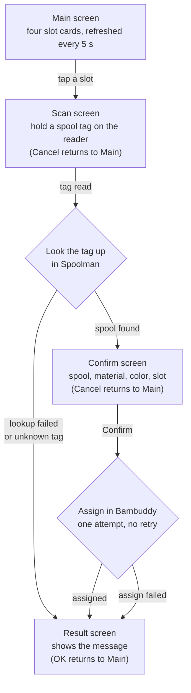

# Filament Selector

Filament Selector is a small ESP32-S3 touchscreen unit that shows what is loaded in a Bambu Lab AMS and assigns a spool to a slot when you scan the spool's NFC tag. It looks the spool up in [Spoolman](https://github.com/Donkie/Spoolman) and records the assignment through [Bambuddy](https://github.com/maziggy/bambuddy). The author tested it with a Bambu Lab X2D with one AMS.

To assign a spool:

1. Tap a slot. The main screen shows all four AMS slots with color, material, remaining percentage and a fill bar.
2. Hold the spool's NFC tag on the reader.
3. Check the spool and color shown, then tap Confirm.

## How it works

The unit never talks to the printer. It reads slot data and writes assignments through Bambuddy, and it reads spool records from Spoolman. A scanned tag is matched by its UID against the `tag` extra field of each Spoolman spool.



A scan ends in one of two places: the Confirm screen when the tag matches a spool, or the Result screen with a message when something goes wrong.



The Result screen shows one of these messages:

| Message | Meaning |
|---|---|
| `Lookup failed: no connection to Spoolman` | Spoolman did not answer. |
| `Lookup failed: HTTP <code>` | Spoolman answered with an error. |
| `Lookup failed: bad reply` | The reply could not be read as a list of spools. |
| `Unknown tag` and the UID | No active spool has this tag. |
| `Assigned to slot <n>` | Bambuddy accepted the assignment. |
| `Assign failed: HTTP <code>` | Bambuddy refused it. |
| `Assign failed: no connection to Bambuddy` | Bambuddy did not answer. |

Some behavior may surprise you:

- Confirming changes Bambuddy only. Nothing is sent to the printer, and Spoolman's location field stays as it was.
- Assigning a spool to a slot removes it from any other slot it was in.
- Archived spools are ignored, and when two spools share a tag the first one in Spoolman's list wins.

Every call the unit makes, with its address, authentication and body, is listed in [docs/API.md](docs/API.md).

## What you need

### Hardware

You need an ES3C40P 4.0" ESP32-S3 display board, a PN532 NFC module, a 4-pin 1.25 mm cable, NFC tags and a soldering iron. [docs/BOM.md](docs/BOM.md) has the full list, and [hardware/case](hardware/case/README.md) has a printable case.

### Wiring

Connect four wires from the PN532 to the display board's I2C socket, then set the PN532 to I2C mode.


The I2C socket is 1.25 mm with 4 pins and is called P4 in the vendor's schematic. Its pins are:

| Socket pin | Signal | Note |
|---|---|---|
| 1 | 3V3 | |
| 2 | GND | |
| 3 | SCL | GPIO15 |
| 4 | SDA | GPIO16 |

Find pin 1 on your board from the vendor's schematic, which the BOM links, and check it against the markings on the board before you wire. The PN532 header in the diagram runs VCC, SDA, SCL, GND, so the GND and SDA wires cross over the others. That header order comes from the author's wiring drawing and has not been checked on the module, so go by the labels printed on your module. The board also has SPI and UART sockets of the same size, so make sure you plug into the I2C one.

The PN532 runs from the board's 3V3 pin, and the author's build works at 3.3 V.

To set the PN532 to I2C mode, put switch 1 ON and switch 2 OFF, then power-cycle the module, because it reads the switches only at power-up.

### Software and services

Bambuddy and Spoolman must be running, ESPHome must be installed on the machine you flash from, and the unit must be able to reach Bambuddy and Spoolman on your network. Power the unit from a 5 V USB-C supply.

| What | Why | Notes |
|---|---|---|
| ESPHome | Builds and flashes the firmware | Needs the `mipi_spi` display, `ft63x6` touchscreen and LVGL (with `rotation`) components, which a current release provides. |
| Bambuddy 1.3.0 or newer | Reports the AMS slots and assigns spools to them | Version 1.3.0 added the `move` option that the firmware sends on Confirm. Your printer must already be added to Bambuddy, and Spoolman must be connected in Bambuddy's settings. |
| Spoolman | Holds your spool records and tags | Needs a `tag` extra field (see [Tagging a spool](#tagging-a-spool)). Spoolman 0.27 and newer also keep tags as native tags. Bambuddy writes both kinds, and the firmware reads the `tag` extra field. |
| Home Assistant (optional) | Receives a `tag_scanned` event | Used only for scans made outside the assign flow. See [Without Home Assistant](#without-home-assistant). |

The author tested the latest releases as of 2026-11-14: ESPHome 2026.10.2, Bambuddy 1.3.1 and Spoolman 0.27.1. The Bambuddy minimum comes from reading its source history, not from testing an older version.

The unit talks to Bambuddy and Spoolman over plain HTTP, so keep all of them on a trusted local network and do not expose them to the internet.

## Setup

1. **Wire it** as shown above.
2. **Create `esphome/secrets.yaml`** from [`secrets.yaml.example`](esphome/secrets.yaml.example) and fill it in.
3. **Edit the config values** listed in [What to change and where](#what-to-change-and-where).
4. **Flash** `esphome/filament-selector.yaml` with ESPHome. See [Flashing](#flashing).
5. **Check the log.** The I2C scan should list `0x24` (PN532) and `0x38` (touch).
6. **Tag your spools.** Each spool needs its tag's UID stored in its Spoolman record, and you read the UID from the running unit's log. See [Tagging a spool](#tagging-a-spool).
7. **Use it.** Tap a slot, scan a tagged spool, check the Confirm screen and tap Confirm. Then open Bambuddy to see the spool in the slot.

## What to change and where

Names in this section are keys in `esphome/filament-selector.yaml`. Search the file for a key, or for "CHANGE ME".

### Required

| Where | What to change |
|---|---|
| `esphome/secrets.yaml` (new file) | Set `wifi_ssid`, `wifi_password`, `api_encryption_key` (generate one with `openssl rand -base64 32`) and `ap_password`. The WiFi must be 2.4 GHz. |
| `filament-selector.yaml`, `bambuddy_url` | Your Bambuddy address, for example `http://192.168.1.50:8000`. |
| `spoolman_url` | Your Spoolman address, for example `http://192.168.1.50:7912`. |
| `printer_id` | Your printer's id in Bambuddy. With one printer it is `1`, which is the default in the file. With several printers, list them with `GET /api/v1/printers/` (see [docs/API.md](docs/API.md)). |

### Only if Bambuddy authentication is on

| Where | What to change |
|---|---|
| `secrets.yaml`, `bambuddy_api_key` | Create an API key in Bambuddy under Settings, API Keys, with only the Read and Inventory permissions, and paste it here. The firmware sends it as the `X-API-Key` header on the status poll and on the assignment. If authentication is off, any value works. |

### Only if your setup differs

| Where | What to change |
|---|---|
| `assign_path` and `assign_id_field` | The defaults assign a Spoolman spool. If your spools live in Bambuddy's own inventory, use `/api/v1/inventory/assignments` and `spool_id`, and change the tag lookup too, because it searches Spoolman. |
| `ams[0]` in the status parser | The parser reads the first AMS unit. Change the index to read a different unit. |
| `root["ams_id"] = 0` in the assignment request | Must match the unit chosen in the `ams[0]` row. Slots are `tray_id` 0 to 3. |
| `rotation: 90` | Use `270` if the screen is upside down. |
| `invert_colors: true` | Remove it if black and white are swapped on your panel. |
| `max_response_buffer_size` (two places: status and spool lookup) | 65536 bytes fits roughly 80 spools by the author's estimate. Raise it if you have more. |
| `sda` and `scl` | The I2C pins. The display board fixes them, so leave them unless you rewire. |
| `name` | The device name in Home Assistant and ESPHome. |
| `touchscreen:` | If taps land in the wrong place, uncomment the `on_touch` and `transform` hints in the file. |
| `homeassistant.tag_scanned` | Delete this line if you do not use Home Assistant. |

## Tagging a spool

The firmware finds a spool by matching the scanned tag's UID, as uppercase hex without separators, against the `tag` extra field on each Spoolman spool. Each spool therefore needs its tag's UID stored there.

1. Scan the tag with the unit idle (no slot selected) and read its UID from the ESPHome log, for example `Tag UID: 04-A1-B2-C3-D4-E5-F6`.
2. Store the UID on the spool without separators, for example `04A1B2C3D4E5F6`. You can edit the `tag` field in Spoolman yourself, or use Bambuddy's tag endpoint (request and example in [docs/API.md](docs/API.md#calls-you-make-once-by-hand)). Bambuddy refuses a tag that another active spool already carries.
3. If Spoolman has no `tag` field, add a text extra field named `tag` for spools in Spoolman's settings.

Spoolman stores the value with quotes around it, and the firmware keeps only the hex characters, so both forms match.

Bambu Lab spools with their own RFID store a long UUID in the same field. A PN532 scan will not match those, but the AMS already tracks them.

## Flashing

The first flash must go over USB. After that, updates work over WiFi.

1. Install ESPHome (see [esphome.io](https://esphome.io)). ESPHome 2026.10.2 installed with Python 3.12 but failed to build on Python 3.15, so use a Python version your ESPHome release supports.
2. Make sure `esphome/secrets.yaml` exists and the CHANGE ME values are filled in.
3. Check the file with `esphome config esphome/filament-selector.yaml`. It should end with "Configuration is valid".
4. Put the board in download mode, using the vendor's procedure: hold the BOOT key while connecting the USB-C cable, then release it. Alternatively, hold BOOT, press and release RESET, then release BOOT.
5. Flash with `esphome run esphome/filament-selector.yaml` and pick the board's serial port when asked.

If you run ESPHome in Docker on macOS, USB cannot be passed into the container. In that case flash and read the serial log from Chrome or Edge, using the ESPHome dashboard at `http://localhost:6052` or web.esphome.io. Serial access needs `localhost` or HTTPS.

## Without Home Assistant

The assign flow does not need Home Assistant. Delete the `homeassistant.tag_scanned` line, and either keep the `api:` block or remove it if you do not use ESPHome's native API.

## Troubleshooting

| Symptom | Likely cause and fix |
|---|---|
| "Found no devices" on the I2C scan, or the PN532 is marked FAILED | Poor solder joints (the module's power LED can be on while the data lines are broken), PN532 not in I2C mode, or SDA and SCL swapped. Check the switches, reflow the joints, then swap SDA and SCL at the connector. |
| `0x38` missing from the scan | The touch controller did not answer. Confirm `sda: GPIO16` and `scl: GPIO15`, then disconnect the PN532. If `0x38` returns, recheck the PN532 wiring. |
| Screen colors are inverted | Add or remove `invert_colors: true`. |
| Taps land in the wrong place | See the `touchscreen:` hints above. Log raw taps with `on_touch` and compare them with the screen size (480 x 320 in landscape). |
| `Unknown tag` after a scan | The tag's UID is not in any active spool's `tag` field. Compare the UID on the screen with the field, and check that the spool is not archived. |
| `Lookup failed: bad reply` | Spoolman answered, but the reply could not be read as a list of spools. The likely cause is a reply larger than the 65536-byte buffer (many spools), so raise `max_response_buffer_size` for the lookup. This cause is inferred from the buffer size and has not been reproduced. |
| `Lookup failed: HTTP` followed by a code | The Spoolman address in `spoolman_url` is wrong or unreachable. |
| `Assign failed: HTTP 401` or `403` | Bambuddy authentication is on. Create an API key with Read and Inventory and put it in `bambuddy_api_key`. |
| `Assign failed: HTTP 404` | Bambuddy could not find the printer or the Spoolman spool. Check `printer_id` and that Spoolman is connected in Bambuddy. |
| Slot tiles stay empty | The status call failed. Check `bambuddy_url` and `printer_id`, and look for "no ams array in status" in the log. |
| Bambu Studio shows the printer offline in LAN-only mode, although `ping` works | A stale Bambu Studio network-plugin file, not this firmware. See [Printer offline in LAN-only mode](#printer-offline-in-lan-only-mode). |
| WiFi will not connect | Use a 2.4 GHz network, spell the SSID exactly as broadcast, and use WPA2 on channels 1 to 11. |

### Printer offline in LAN-only mode

If Bambu Studio shows the printer as offline while `ping` works and the printer's ports answer, the cause may be a stale or corrupted `BambuNetworkEngine.conf`, the configuration file of Bambu Studio's closed-source network plugin. Restarting Bambu Studio fixes it for a few days, and deleting or moving that file fixes it for longer. Close Bambu Studio, remove the file as below, and start it again. Bambu Studio recreates the file, and you may need to reconnect the printer.

On macOS, move the file aside so you keep a backup:

```
mv ~/Library/Application\ Support/BambuStudio/BambuNetworkEngine.conf ~/Library/Application\ Support/BambuStudio/BambuNetworkEngine.conf-BACKUP
```

On Windows, run these in a command prompt:

```
del "%APPDATA%\BambuStudio\BambuNetworkEngine.conf"
del "%APPDATA%\BambuStudio\BambuNetworkEngine.conf.bak"
rmdir /s /q "%LOCALAPPDATA%\BambuStudio\WebView2Cache"
```

This comes from a [third-party blog post](https://robig.net/blog/posts/connect-to-bambulab-x2d-on-lan-only-mode/) written for a Bambu Lab X2D, and its author reports no connection problems since. The repository owner tried it and found the connection more stable. It affects only Bambu Studio's own connection. The NFC unit talks to Bambuddy, which does not use this file.

## Limitations

- The unit shows one AMS unit (four slots). Multiple units or an AMS HT need more tiles and a different unit index.
- Every scan downloads Spoolman's whole spool list. That is fine for a typical collection but grows with the number of spools.
- The unit supports plain HTTP on a trusted local network only.

## License

This project is licensed under the Apache License 2.0. See [LICENSE](LICENSE).

Bambuddy (AGPL-3.0) and Spoolman (MIT) are separate programs that the unit talks to over HTTP, and no code from them is included. [THIRD_PARTY_NOTICES.md](THIRD_PARTY_NOTICES.md) has the details, and [SECURITY.md](SECURITY.md) explains how to report a problem and the design limits.
