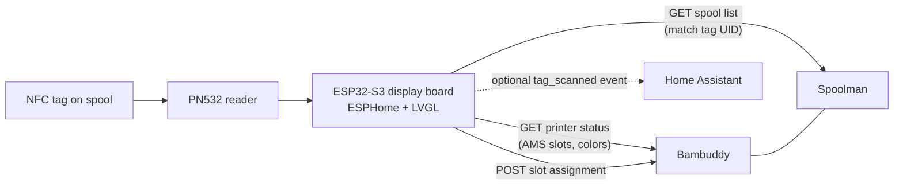
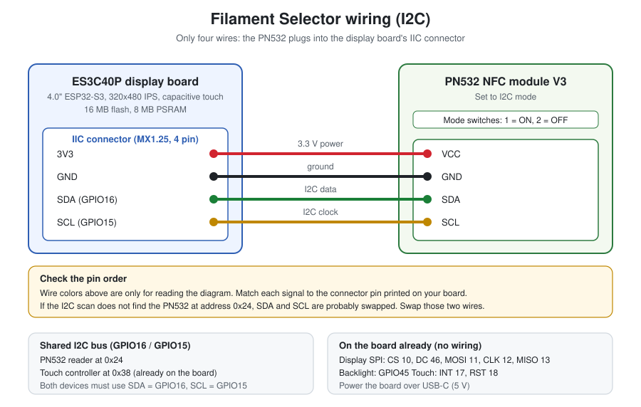

# Filament Selector

A small ESP32-S3 touchscreen unit that shows what is loaded in a Bambu Lab AMS and lets you assign a spool to a slot by scanning its NFC tag.

1. The screen shows the four AMS slots with color, material, remaining percentage and a fill bar.
2. Tap a slot.
3. Hold a spool's NFC tag on the reader.
4. Check the spool and color shown, then tap Confirm.

The spool is looked up in [Spoolman](https://github.com/Donkie/Spoolman) and assigned to the slot through [Bambuddy](https://github.com/maziggy/bambuddy). Tested with a Bambu Lab X2D with one AMS.

## How it works

- Slot data comes from Bambuddy's printer status.
- The scanned tag's UID is matched against the `tag` extra field on each Spoolman spool.
- Confirm sends the Spoolman spool id and the slot to Bambuddy's Spoolman slot-assignment endpoint.

## What you need

### Hardware

See [docs/BOM.md](docs/BOM.md). In short: an ES3C40P 4.0" ESP32-S3 display board, a PN532 NFC module, a 4-pin MX1.25 cable and NFC tags. A printable case is in [hardware/case](hardware/case/README.md).

### Wiring

Four wires from the PN532 to the display board's IIC connector: 3V3, GND, SDA (GPIO16) and SCL (GPIO15). Set the PN532 to I2C mode (switch 1 ON, switch 2 OFF) and power-cycle it, because it only reads the switches at power-up.

### Software and services

| What | Why | Notes |
|---|---|---|
| ESPHome (recent release) | Builds and flashes the firmware | Needs the `mipi_spi` display, `ft63x6` touchscreen and LVGL (with `rotation`) components, so use a current release. |
| Bambuddy | Reports the AMS slots and assigns spools to slots | Your printer must already be added to Bambuddy. Spoolman must be connected in Bambuddy's settings. |
| Spoolman | Holds your spool records and tags | Reachable from the ESP32 on your network. |
| Home Assistant | Optional | Only used for the `tag_scanned` event on scans made outside the assign flow. See [Without Home Assistant](#without-home-assistant). |

Everything must be reachable over plain HTTP on your local network. Do not expose these services to the internet for this.

## Setup

1. **Wire it** as shown above.
2. **Create `esphome/secrets.yaml`** from [`secrets.yaml.example`](esphome/secrets.yaml.example) and fill it in.
3. **Edit the config values** listed in [What to change and where](#what-to-change-and-where).
4. **Tag your spools.** Each spool needs its tag's UID stored in its Spoolman record. See [Tagging a spool](#tagging-a-spool).
5. **Flash** `esphome/filament-selector.yaml` with ESPHome. See [Flashing notes](#flashing-notes).
6. **Check the log.** The I2C scan should list `0x24` (PN532) and `0x38` (touch).
7. **Use it.** Tap a slot, scan a tagged spool, check the confirm screen and tap Confirm. Open Bambuddy to see the spool in the slot.

## What to change and where

Line numbers refer to `esphome/filament-selector.yaml` as committed.

### Required

| Where | What to change |
|---|---|
| `esphome/secrets.yaml` (new file) | Set `wifi_ssid`, `wifi_password`, `api_encryption_key` (generate with `openssl rand -base64 32`) and `ap_password`. The WiFi must be 2.4 GHz. |
| `filament-selector.yaml` line 9, `bambuddy_url` | Your Bambuddy address, for example `http://192.168.1.50:8000`. |
| line 10, `spoolman_url` | Your Spoolman address, for example `http://192.168.1.50:7912`. |
| line 11, `printer_id` | Your printer's id in Bambuddy. The value is also in the URL of API calls like `/api/v1/printers/<id>/status`. |

### Only if Bambuddy authentication is on

| Where | What to change |
|---|---|
| `secrets.yaml`, `bambuddy_api_key` | Create an API key in Bambuddy under Settings, API Keys, with the Read and Inventory permissions only. Paste it here. It is sent as the `X-API-Key` header on the status poll (line 128) and the assignment (line 717). If authentication is off, any value works. |

### Only if your setup differs

| Where | What to change |
|---|---|
| lines 16 and 17, `assign_path` and `assign_id_field` | Defaults assign a Spoolman spool. If your spools live in Bambuddy's own inventory, use `/api/v1/inventory/assignments` and `spool_id`. The tag lookup (around line 213) also searches Spoolman, so a local-inventory setup needs that lookup changed too. |
| lines 148, 149 and 153, `ams[0]` | The status parser reads the first AMS unit. For a different unit, change the index. |
| line 722, `root["ams_id"] = 0` | Must match the AMS unit above. Slots are `tray_id` 0 to 3. |
| line 279, `rotation: 90` | Use `270` if the screen is upside down. |
| line 74, `invert_colors: true` | Remove it if colors look inverted on your panel (black and white swapped). |
| line 130 and 213, `max_response_buffer_size` | 65536 bytes fits roughly 80 spools. Raise it if you have more. |
| lines 41 and 42, `sda` and `scl` | Pin choice for the I2C bus. The display board's connector and touch controller fix these, so leave them unless you rewire. |
| line 20, `name` | Device name in Home Assistant and ESPHome. |
| `touchscreen:` (line 78) | If taps land in the wrong place, uncomment the `on_touch` and `transform` hints in the file. |
| line 272, `homeassistant.tag_scanned` | Delete this line if you do not use Home Assistant. |

## Tagging a spool

The firmware matches the scanned tag's UID, as uppercase hex without separators, against the `tag` extra field on each Spoolman spool.

1. Scan the tag with the device idle (no slot selected) and read its UID from the ESPHome log, for example `Tag UID: 04-A1-B2-C3-D4-E5-F6`.
2. Store it on the spool, for example `04A1B2C3D4E5F6`. Bambuddy's `PATCH /api/v1/spoolman/inventory/spools/{spool_id}/tag` writes it into Spoolman's `tag` extra field, or you can edit that field in Spoolman yourself. Bambuddy refuses a tag that another active spool already carries.
3. If Spoolman has no `tag` field, add a text extra field named `tag` for spools under Spoolman's settings.

Spoolman stores the value with quotes around it. The firmware strips everything except hex characters, so both forms match.

Bambu Lab spools with their own RFID store a long UUID in the same field. Those will not match a PN532 scan, but the AMS already tracks them.

## Flashing notes

- Docker Desktop on macOS cannot pass USB into a container. Flash and read the serial log from Chrome or Edge using the ESPHome dashboard at `http://localhost:6052`, or use web.esphome.io. Serial needs `localhost` or HTTPS.
- The device logs over USB at first. After the first flash, updates work over WiFi.

## Without Home Assistant

The config does not need Home Assistant for the assign flow. Delete the `homeassistant.tag_scanned` line (272). The `api:` block can stay, or you can remove it if you do not use ESPHome's native API.

## Troubleshooting

| Symptom | Likely cause and fix |
|---|---|
| "Found no devices" on the I2C scan, or the PN532 is marked FAILED | Poor solder joints (the module's power LED can be on while data lines are broken), PN532 not in I2C mode, or SDA and SCL swapped. Check the switches, reflow the joints, then swap SDA and SCL at the connector. |
| `0x38` missing from the scan | The touch controller did not answer. Confirm `sda: GPIO16` and `scl: GPIO15` and that the PN532 wires are not crossed. |
| Screen colors are inverted | Add or remove `invert_colors: true`. |
| Taps land in the wrong place | See the `touchscreen:` hints above. Log raw taps with `on_touch` and compare with the screen size (480 x 320 in landscape). |
| "Unknown tag" after a scan | The tag's UID is not in any Spoolman spool's `tag` field. Check the UID in the log against the field. |
| `Lookup failed: HTTP` followed by a code | The Spoolman address in `spoolman_url` is wrong or unreachable. |
| `Assign failed: HTTP 401` or `403` | Bambuddy authentication is on. Create an API key with Read and Inventory, put it in `bambuddy_api_key`. |
| `Assign failed: HTTP 404` | The printer id or the Spoolman spool was not found. Check `printer_id`, and that Spoolman is connected in Bambuddy. |
| Slot tiles stay empty | The status call failed. Check `bambuddy_url` and `printer_id`, and look for "no ams array in status" in the log. |
| WiFi will not connect | Use a 2.4 GHz network, spell the SSID exactly as broadcast, and use WPA2 on channels 1 to 11. |

## Limitations

- Shows one AMS unit (four slots). Multiple units or an AMS HT need more tiles and the unit index changes.
- The tag lookup downloads Spoolman's whole spool list on every scan. That is fine for a typical collection, but it grows with the number of spools.
- Plain HTTP on a trusted LAN only.
- The printable case is included, but the TPU washers it uses are not yet. See [hardware/case](hardware/case/README.md).
